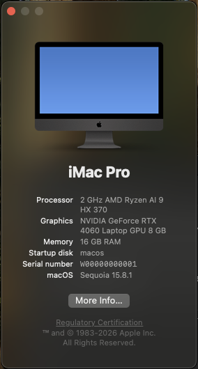
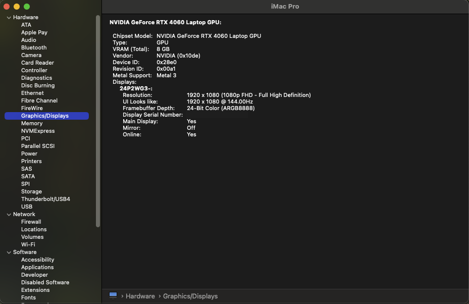

<div align="center">

# ROG 幻16 Air 上的 KVM 黑苹果，直通 RTX 4060

**在 2024 款 ROG 幻16 Air（GA605W，AMD 版）上，用 QEMU/KVM 跑带 Metal 加速的 macOS Sequoia：<br>
锐龙 AI 9 HX 370 + RTX 4060 Laptop，宿主机 Arch Linux。**

[](#测试环境)
[](#现在能做到什么)
[](#现在能做到什么)
[](#测试环境)
[](LICENSE)

[快速开始](#快速开始) · [踩坑记录](docs/troubleshooting.zh-CN.md) · [给 AI 助手的步骤](AGENTS.zh-CN.md) · [English](README.md)

<br>


&nbsp;&nbsp;


<sub>macOS 的桌面是 4060 画的，从机身 HDMI 口以 1080p 144 Hz 输出。</sub>

</div>

## 这是什么，适合谁

一句话：**Linux 照常用，需要 macOS 的时候开个虚拟机，把 4060 借给它，macOS 就有了真正的显卡加速。**

这套东西是在**一台具体的机器**上折腾出来的：2024 款华硕 **ROG 幻16 Air**（海外叫 ROG Zephyrus G16，AMD 版，
型号 GA605W），锐龙 AI 9 HX 370 带 Radeon 890M 核显，独显是 RTX 4060 Laptop，系统是 **Arch Linux + KDE Plasma**。
文档里写的每一步、每个坑，都是在这台机器上实际遇到过、验证过的。

先说清楚，它**不是传统意义上的黑苹果**：没有把 macOS 装到硬盘上替换 Linux。Linux 一直是主系统，macOS 跑在
QEMU/KVM 虚拟机里；虚拟机开着的时候，4060 通过 VFIO 直通给它，关掉以后再还给 Linux。

之所以能这么玩，靠的是 [NullMoth 的开源 NVIDIA Metal 驱动](https://github.com/nullmoth/nvidia-macos-driver)。
苹果早就不给 N 卡出驱动了，以前 RTX 系列在 macOS 上基本只能当摆设，这个驱动让它重新能跑 Metal。

别的机器能不能用？我的看法是：**思路通用，脚本要改**。只要你的独显能单独直通、有显示接口直接接在独显上、
桌面能跑在另一块显卡上，就值得一试（怎么检查见 [AGENTS.zh-CN.md 第 1 步](AGENTS.zh-CN.md#第-1-步检查硬件)）。
但 PCI 地址、哪个口接独显、桌面环境这些，肯定得按自己的机器调。

## 现在能做到什么

| | |
|---|---|
| 显卡 | RTX 4060 Laptop（`10de:28e0`），8 GB，Metal 3，桌面合成也走显卡 |
| 显示 | 机身 HDMI 口，1080p 144 Hz；OpenCore 和开机跑码也从这个口出（用的是显卡自己的 GOP） |
| 开机 | 不用管：不停选盘界面、自动登录，大概 2 分钟（其中显卡初始化就要 100 秒左右） |
| 键鼠 | 平时用 Deskflow，鼠标从笔记本屏幕左右边缘移出去就进 macOS；另外留了 evdev 直通兜底，同时按左右 Shift 切换 |
| 远程看 | macOS 自带的屏幕共享，在 Linux 里开个 TigerVNC 窗口看，大概 20–30 帧 |
| 宿主机 | 笔记本照样用核显和内屏；`host.sh off` 之后 4060 还给 NVIDIA 驱动 |

做不到的：HDMI 声音、睡眠唤醒、高帧率的远程画面；另外**不接显示器就没有桌面**，想无头运行得插个
HDMI 欺骗器。细节见[踩坑记录最后一节](docs/troubleshooting.zh-CN.md#已知限制)。

## 我在意的几件事

- **宿主机改了什么，一个脚本说了算。** 所有对 Linux 的改动都在 `scripts/host.sh` 里，`status` 能列出来，
  `rollback` 能全部撤销。我不喜欢那种“照着教程敲了一堆命令，回头不知道改过什么”的状态。
- **下载的东西都锁版本、对哈希。** kext、驱动、Deskflow 都由 `scripts/fetch.sh` 下载并校验 SHA-256，
  仓库里不放任何第三方二进制。
- **不存密码。** 要密码的地方都是运行时问你；磁盘镜像、SSH 密钥这些私有数据全在 git 忽略的 `state/` 里。
- **能交给 AI 助手照着做。** [AGENTS.zh-CN.md](AGENTS.zh-CN.md) 是写给 Claude Code 这类编程助手的完整步骤，
  每一步都有检查点，也写明了什么时候必须停下来问你。

## 测试环境

| | |
|---|---|
| 机器 | ROG 幻16 Air 2024（GA605WV）：锐龙 AI 9 HX 370 + Radeon 890M + RTX 4060 Laptop，MUX 在混合模式 |
| 宿主机 | Arch Linux，内核 7.2，QEMU 11.1，KDE Plasma 6.8（Wayland），nvidia-open 615.78 |
| 虚拟机 | macOS 15.8.1（24H32），SMBIOS 用 iMacPro1,1，OpenCore 来自 OSX-KVM，NullMoth 驱动 2.5.3 |

## 快速开始

完整流程和每一步的检查方法在 [AGENTS.zh-CN.md](AGENTS.zh-CN.md)，这里是个骨架：

```sh
cp config.example.env config.env    # 填 PCI 地址、核显、键鼠名字、虚拟机规格、macOS 用户名
scripts/fetch.sh                    # 下载依赖（锁版本 + SHA-256）、做恢复盘、建空系统盘
opencore/build.sh                   # 生成两块 OpenCore 引导盘

sudo scripts/host.sh prepare        # 宿主机设置（ignore_msrs、KWin、memlock、Deskflow），显卡先不动
scripts/boot-macos.sh               # 第一步：在 QEMU 窗口里装 macOS（选盘界面按空格 → RECOVERY）
                                    #   装完在 macOS 里打开“远程登录”，然后：
scripts/guest.sh ssh && scripts/guest.sh prefs

sudo scripts/host.sh on             # 第二步：把显卡交给虚拟机（KWin 占着的话注销重登一次）
PASSTHROUGH=1 OPENCORE_IMG=state/opencore/OpenCore-imacpro.qcow2 scripts/boot-macos.sh
scripts/guest.sh driver             #   装 NullMoth 驱动，装完关机

PASSTHROUGH=1 scripts/boot-macos.sh # 第三步：正式直通启动，画面从显卡的口出来
scripts/guest.sh autologin && scripts/guest.sh deskflow && scripts/guest.sh screensharing
```

## 日常怎么用

```sh
sudo scripts/host.sh on                 # 显卡给虚拟机（已经给过就什么都不做）
PASSTHROUGH=1 scripts/boot-macos.sh     # 开机 20 秒后键鼠会被虚拟机接管，同时按左右 Shift 拿回来
                                        # 大概 2 分钟后 macOS 自动登录，Deskflow 连上，鼠标往左右边缘一甩就过去了
vncviewer 127.0.0.1::5900               # 想在 Linux 窗口里看一眼 macOS 的话
scripts/guest.sh shell                  # SSH 进 macOS
# 在 macOS 里关机，然后：
sudo scripts/host.sh off                # 显卡还给 NVIDIA 驱动，BAR1 恢复原来的大小
```

## 宿主机到底改了什么

`sudo scripts/host.sh status` 随时能看，`rollback` 一键撤销。

| # | 改动 | 为什么非改不可 |
|---|---|---|
| 1 | `~/.config/environment.d/90-macos-vm-kwin.conf`：`KWIN_DRM_DEVICES=<核显>`（必要时加个 udev 软链接） | 不改的话 KWin 会一直占着独显，根本卸不掉驱动 |
| 2 | KWin 服务加个 drop-in，只用 Mesa 的 EGL | 光有第 1 条不够，glvnd 还是会先加载 NVIDIA 的 EGL，在独显上留个上下文 |
| 3 | `user@.service` 加 drop-in：`LimitMEMLOCK=infinity` | 直通要锁住虚拟机全部内存；`limits.d` 对 KDE 桌面会话不起作用 |
| 4 | `/etc/modprobe.d/kvm.conf`：`ignore_msrs=1` | macOS 会读 KVM 没模拟的 MSR，不忽略就崩 |
| 5 | 运行时：显卡绑到 `vfio-pci`，卸掉 nvidia 模块 | 直通本身 |
| 6 | 运行时：BAR1 从 8 GiB 缩到 256 MiB | 8 GiB 的 BAR1 会让 QEMU 在 macOS 配置 PCI 时直接崩掉 |
| 7 | `pacman -S deskflow` | 键鼠共享 |
| 8 | `~/.config/Deskflow/Deskflow.conf` | Deskflow 服务端，只监听本机 |

1、2、8 重新登录后生效，3、4 重启后生效（这期间 `on` 会临时给当前终端放开 memlock，不用急着重启）。
第 1 条有个代价：开着的时候，宿主机桌面用不了接在独显上的接口，比如 HDMI。反正 HDMI 这时候是给 macOS 用的，
我觉得可以接受。

## 踩过的坑

一共三十来个，全在 [docs/troubleshooting.zh-CN.md](docs/troubleshooting.zh-CN.md)，每条都写了“看到什么 → 为什么 →
脚本里怎么处理的”。最折腾的几个：

- 显卡的 BAR 根本没分配到地址，macOS 看不到卡；
- 显卡挂在 PCIe 根端口后面，macOS 认为插槽是空的，压根不去扫；
- 8 GiB 的大 BAR 让 QEMU 直接崩溃退出；
- WindowServer 无限重启，而且是两个完全不同的原因造成的同一个现象；
- 换成 iMacPro 机型后，苹果的 MCE 驱动在虚拟机里空指针 panic；
- “关于本机”里的处理器名死活改不过来，最后靠调试版 kext 的日志才查明白。

## 目录

```
config.example.env    机器参数模板（复制成 config.env，不进 git）
scripts/              fetch.sh 下载、boot-macos.sh 启动、host.sh 宿主机、guest.sh 配置 macOS、qmp.py 控制虚拟机
opencore/             生成 OpenCore 引导盘；patch-config.py 里每一处改动都写了原因
deskflow/             Deskflow 布局和设置模板
docs/                 踩坑记录（中英文）、截图
state/                （不进 git）系统盘、固件变量、下载文件、SSH 密钥、宿主机备份
```

## 致谢和声明

核心是 [NullMoth 的驱动](https://github.com/nullmoth/nvidia-macos-driver)；另外用到了
[OSX-KVM](https://github.com/kholia/OSX-KVM)、acidanthera 的 [OpenCore](https://github.com/acidanthera/OpenCorePkg) /
[Lilu](https://github.com/acidanthera/Lilu) / [RestrictEvents](https://github.com/acidanthera/RestrictEvents)、
[OpenCore Legacy Patcher](https://github.com/dortania/OpenCore-Legacy-Patcher) 里的 AMFIPass，以及
[Deskflow](https://github.com/deskflow/deskflow)。这些都由 `scripts/fetch.sh` 从原地址下载，本仓库不分发。

本仓库的脚本用 MIT 许可（[LICENSE](LICENSE)）。苹果的许可只允许在苹果硬件上运行 macOS，这个项目的定位是研究和学习，
用不用、怎么用，请自己判断并遵守相应的许可。
